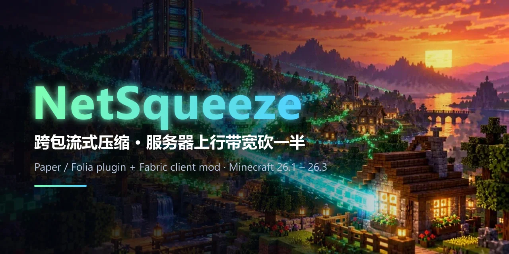
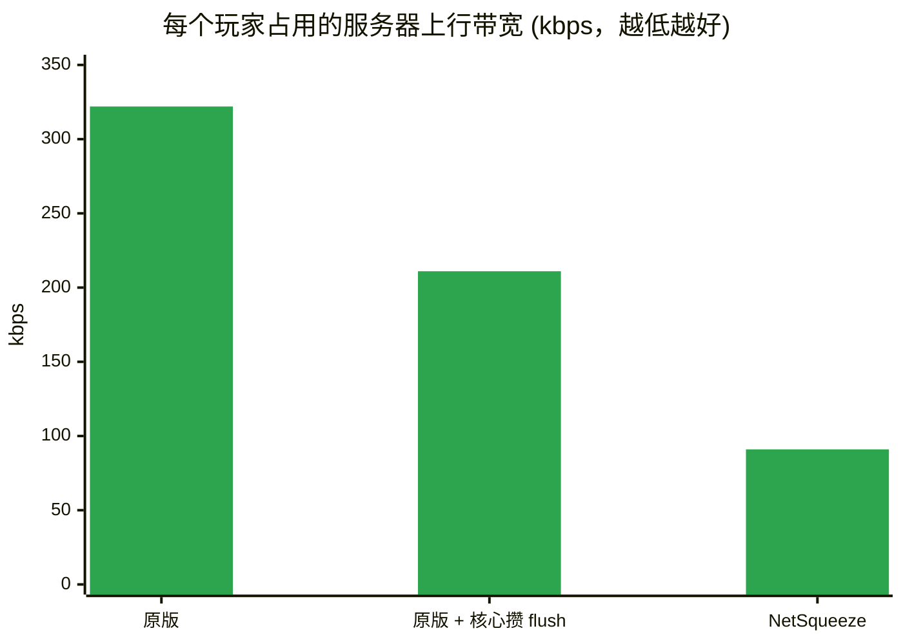
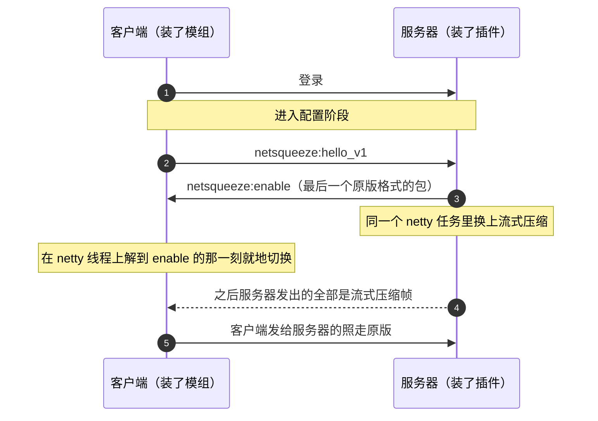

<div align="center">



<br/>

**服务器发给玩家的数据，按 tick 攒成一帧、整条连接共用一个压缩流。<br/>装了模组的玩家占用的服务器上行带宽砍一半以上，没装的什么都不变。**

**对按带宽或流量计费的服务器，带宽成本随之大幅下降。**

<br/>

[](https://github.com/eternity4719/NetSqueeze/actions/workflows/build.yml)


[为什么能省](#-为什么能省) · [实测](#-实测) · [安装](#-安装) · [命令](#-命令) · [给其他插件](#-给其他插件判断玩家装没装模组) · [协议](#-协议)

</div>

---

## ✨ 特性

<table>
<tr>
<td width="33%" valign="top">

### 📉 省一半以上
同一 tick 的包合成一帧，整条连接共用一个 deflate 流，前面发过的内容后面直接引用，重复越多省得越多。

</td>
<td width="33%" valign="top">

### 🔌 两边各装一个
服务端一个插件，不改核心；客户端一个 Fabric 模组，**不需要 Fabric API**。

</td>
<td width="33%" valign="top">

### 🛡️ 谁没装都不坏
握手没对上就退回原版。没装模组的玩家照常进服，装了模组的玩家照常去别的服务器。

</td>
</tr>
<tr>
<td valign="top">

### ⏱️ 零额外延迟
攒帧边界就是服务器本来的 flush，不加定时器、不等包。

</td>
<td valign="top">

### 🧩 和网络插件共存
ViaVersion、PacketEvents、Grim、ProtocolLib、TAB 同装实测，它们照常看到每一个包。

</td>
<td valign="top">

### 🎁 能识别、能发奖励
装了模组的玩家身上有 metadata，别的插件一行代码就能判断，伪造不了。

</td>
</tr>
</table>

## 🤔 为什么能省

原版的网络压缩是**一个包一个包单独压**的，小于阈值（默认 256 字节）的包干脆原样发。可游戏里占大头的恰恰是
实体移动、声音、方块变化这类几十字节的小包，每个包还各自带一份帧头，经常各占一个 TCP 段。


## 📊 实测

永恒世界服务器实测（Canvas 26.1.2，约 250 人在线，玩家多为 26.1.2 客户端），稳态下**每个玩家占用的服务器上行带宽**（含 TCP/IP 包头估算）：



| | 人均上行 | 说明 |
|---|---|---|
| 原版 | 322 kbps | 未改核心，95% 的 flush 只带 1 个包，TCP/IP 包头约占三分之一 |
| 原版 + 核心攒 flush | 211 kbps | 服务端本地补丁把暂停 flush 扩到整个区域 tick，每人每 tick 约 1 次 flush |
| **NetSqueeze** | **91 kbps** | 在上一行基础上再**少 57%**（同期影子估算：没装模组的玩家也按新格式在服务端压一遍，只统计大小、不发出去） |

- 单个装了模组的玩家刚进服大量加载区块时，实际出网只有原始包大小的 **12%** 左右。
- 服务端开销：deflate level 6，约 250 人时总共占 **0.7 个 CPU 核心**左右，分摊在 netty 线程上，不占 tick 线程；
  每条连接常驻约 300 KB 压缩状态。

> [!NOTE]
> **flush 次数决定能攒多少。** Folia 系核心原本只在区域 tick 的后半段暂停 flush，前半段（处理玩家发来的包、区域任务、
> 实体调度器）里发的包一个包 flush 一次。NetSqueeze 在没改过核心的服务器上照样能用，只是每帧攒到的包少，省的比例会低一些。

## 🔄 工作流程



服务器没装插件时收不到 `enable`，客户端在配置阶段结束时自己撤掉，之后零开销。

## 📦 要求

| | 服务端 | 客户端 |
|---|---|---|
| Minecraft | **26.1.x** 的 Paper / Folia 系 | **26.1 ~ 26.3**（一个 jar 通用） |
| 运行环境 | Java 25 | Fabric Loader 0.19+，**不需要 Fabric API** |
| 前置 | [CoreLib](https://github.com/eternity4719/CoreLib)（同仓库构建出 `CoreLib` 和提供 Kotlin 运行库的 `CoreLibRuntime`，两个都装） | 无 |

<details>
<summary>测试覆盖范围</summary>

- 服务端开发和线上都跑在 Canvas 26.1.2；插件直接用到服务端内部类，绑定 26.1.x。纯 Paper、Purpur 没有专门测过。
- 客户端按 26.1.2 编译，26.1、26.1.1、26.1.2、26.2、26.3 五个正式版逐个核对过用到的类、方法和登录流程。
- 正版服务器的加密已经处理，但永恒世界是离线模式，正版场景没有实测过。

</details>

## 🚀 安装

插件和模组都在 [Releases](https://github.com/eternity4719/NetSqueeze/releases) 下载；最新提交的构建在
[Actions](https://github.com/eternity4719/NetSqueeze/actions/workflows/build.yml) 里每次运行的 Artifacts 中。

1. **服务端**：`plugins/` 里放 CoreLib、CoreLibRuntime 和 `NetSqueeze-x.x.x-all.jar`，重启。
2. **客户端**：`NetSqueeze-Client-x.x.x.jar` 放进 `mods/`。
3. 玩家照常进服就行。客户端 `logs/latest.log` 里出现 `服务器已启用流式压缩`，就说明已经生效。

## 💻 命令

权限 `netsqueeze.admin`（默认 OP）。

| 命令 | 作用 |
|---|---|
| `/nsq` | 装和没装模组两类玩家各自的出网、TCP/IP 包头估算、人均带宽，以及压缩耗时 |
| `/nsq players` | 按实际出网给玩家排行，装了模组的标 `[mod]` |
| `/nsq reset` | 统计清零（不影响压缩状态） |
| `/nsq pipeline` | 两类玩家最近一次进服时的 netty 管线，排查和其他网络插件的顺序 |

## 🎁 给其他插件：判断玩家装没装模组

装了模组的在线玩家身上有 metadata `netsqueeze_mod`（值为 `true`），进服事件的 LOWEST 阶段就已经打上，
其他插件在自己的进服监听里就能读到：

```java
boolean modded = player.hasMetadata("netsqueeze_mod");
```

伪造握手、却不会解压的客户端，会在服务器切到新格式后立刻掉线。所以带着这个标记还能正常在线的，就是真装了模组，
可以放心拿来发奖励。

## ⚠️ 注意

- **热重载**（PlugManX 等）：已经切到新格式的连接没法交接给新的插件实例，卸载时会给这些玩家发一条
  「服务器网络组件更新，请重新连接」后断开，没装模组的玩家无感。建议放在定时重启里更新插件。
- 压缩出错没法退回原版（客户端已经切换），出错的连接会被断开，第一条堆栈打在后台，`/nsq` 里能看到出错次数。

## 📜 协议

<details>
<summary>想在 Velocity、NeoForge 等平台实现兼容端，展开看完整约定</summary>

两端协议有变化时，版本号一起改。

1. 客户端登录完成、出站协议切到配置阶段后，发送自定义包 `netsqueeze:hello_v1`，**不带数据**
   （版本号编在频道名里，原版客户端的 `DiscardedPayload` 不带数据）。
2. 服务端认得这个版本，就在这条连接的 netty 线程上：先按原版格式发 `netsqueeze:enable`（不带数据），
   紧接着换掉出站格式。`enable` 是这条连接最后一个原版格式的包，之后服务端发出的字节全是新格式。
   服务端不认得就什么都不回，客户端在配置阶段结束时撤掉自己，照走原版。
3. 新格式的帧：`varint 帧长` + `deflate 输出`。整条连接共用一个 raw deflate 流（nowrap，不带 zlib 头），
   每帧以 `SYNC_FLUSH` 结尾，保证每帧解压出来都是完整的包。解压后是一串 `varint 包长` + `包字节`
   （包 id + 包体，不再有原版的压缩长度前缀）。
4. 客户端必须在 netty 线程上、解到 `enable` 的那一刻就切换：同一批收到的字节里，紧跟在后面的已经是新格式了。

</details>

## 🛠️ 构建

<details>
<summary>需要 JDK 25</summary>

```bash
# 先把 CoreLib 发布到本地 maven（顺带构建出 CoreLib 和 CoreLibRuntime 两个插件 jar）
git clone https://github.com/eternity4719/CoreLib
cd CoreLib && ./gradlew build publishToMavenLocal

# 再构建本仓库：插件在 build/libs/*-all.jar，客户端模组在 client/build/libs/
./gradlew build
```

`client/` 是根构建的子项目，Fabric Loom 在根项目上统一声明。

GitHub Actions（`.github/workflows/build.yml`）每次推送都会照上面的步骤构建，两个 jar 作为 Artifacts 上传。
发版不用手动打标签：改了 `build.gradle.kts` 里的插件版本号推到 master，GitHub 上还没有这个版本的 Release 时，
会自动打 `v<版本号>` 标签并发布，附上两个 jar。

</details>

## 🙏 致谢

思路来自 NeoForge 模组 [NotEnoughBandwidth](https://github.com/USS-Shenzhou/NotEnoughBandwidth)（只有 NeoForge 版、两端必装）。
NetSqueeze 是独立实现，没有用它的代码。

## 📄 许可

[MIT](LICENSE)
