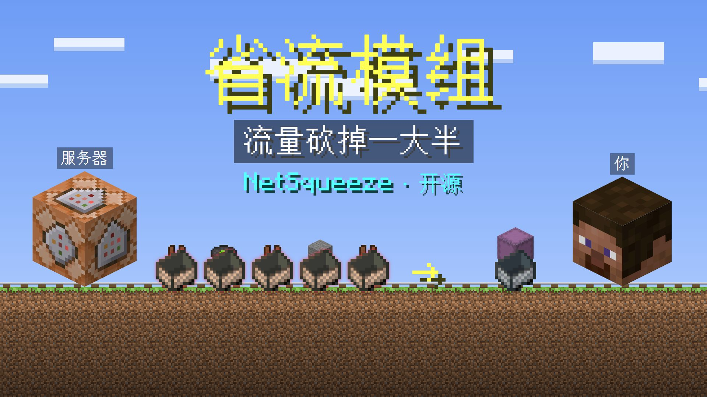
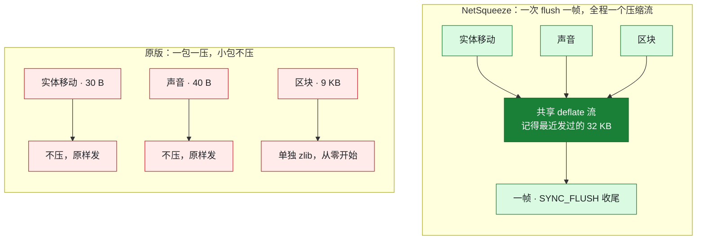
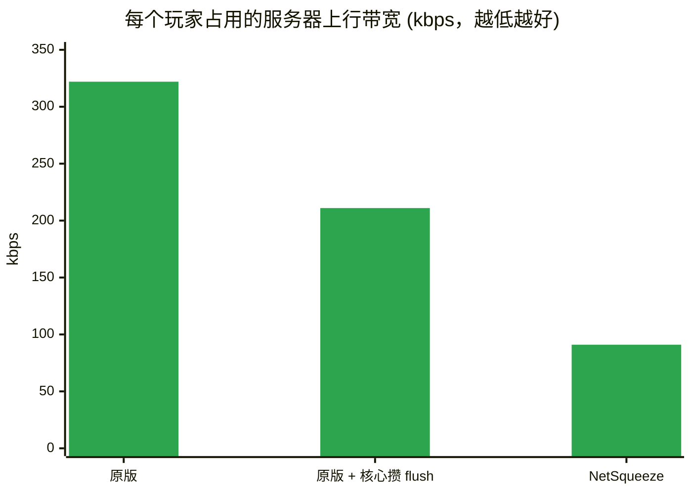
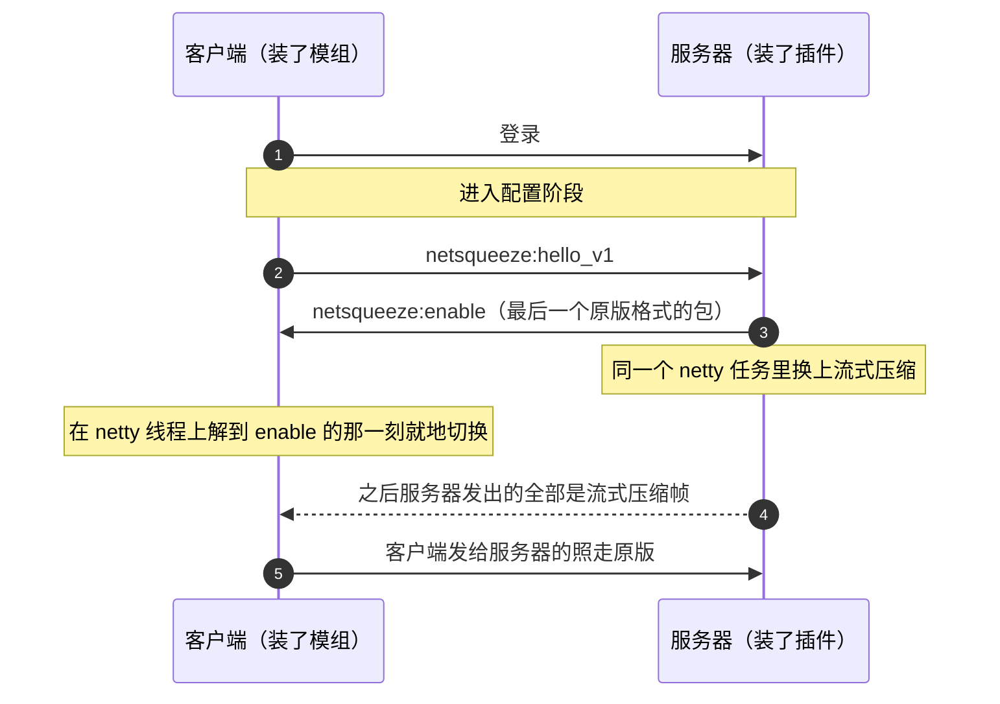

<div align="center">


<br/>

**GoldenCarrot服务器维护的网络压缩分支。直连按 flush 攒帧、连接共享压缩流；Velocity 路径使用普通载荷隧道。<br/>压缩收益取决于传输模式与实际流量，没装模组的保持原版。**

**用于减少网络冗余；是否降低带宽成本，需要在实际出口测量。**

<br/>

[](https://github.com/GoldenCarrotMCS/NetSqueeze_Plus/actions/workflows/build.yml)


[](https://www.bilibili.com/video/BV1kkx46UEiQ/)

[原理视频](#-原理视频) · [为什么能省](#-为什么能省) · [实测](#-实测) · [安装](#-安装) · [命令](#-命令) · [给其他插件](#-给其他插件判断玩家装没装模组) · [协议](#-协议)

</div>

---

## ✨ 特性

<table>
<tr>
<td width="33%" valign="top">

### 📉 减少重复数据
同一 tick 的包合成一帧，整条连接共用一个 deflate 流，前面发过的内容后面直接引用，重复越多省得越多。

</td>
<td width="33%" valign="top">

### 🔌 两边各装一个
服务端一个插件，不改核心；客户端一个 Fabric 模组，**不需要 Fabric API**。

</td>
<td width="33%" valign="top">

### 🛡️ 谁没装都不坏
握手没有成功就保持原版。没装模组的玩家照常进服，装了模组的玩家照常去别的服务器。

</td>
</tr>
<tr>
<td valign="top">

### ⏱️ 不定时攒包
攒帧边界就是服务器本来的 flush，不加定时器、不等包。

</td>
<td valign="top">

### 🧩 和网络插件共存
ViaVersion、PacketEvents、Grim、ProtocolLib、TAB 同装实测，它们照常看到每一个包。

</td>
<td valign="top">

### 🎁 能识别、能发奖励
启用流式协议的玩家身上有 metadata，别的插件可用它判断协议能力；这不是客户端身份认证。

</td>
</tr>
</table>

## 🎬 原理视频

两分钟看懂：用矿车打比方讲原版为什么费流量、NetSqueeze 怎么省，附实测数据。点图去 B 站观看：

<a href="https://www.bilibili.com/video/BV1kkx46UEiQ/"></a>

## 🤔 为什么能省

原版的网络压缩是**一个包一个包单独压**的，小于阈值（默认 256 字节）的包干脆原样发。可游戏里占大头的恰恰是
实体移动、声音、方块变化这类几十字节的小包，每个包还各自带一份帧头，经常各占一个 TCP 段。



## 📊 实测

GoldenCarrot服务器维护此分支。以下为上游历史参考数据，并非 GoldenCarrot服务器复测结果（Canvas 26.1.2，约 250 人在线，玩家多为 26.1.2 客户端），稳态下**每个玩家占用的服务器上行带宽**（含 TCP/IP 包头估算）：



| | 人均上行 | 说明 |
|---|---|---|
| 原版 | 322 kbps | 未改核心，95% 的 flush 只带 1 个包，TCP/IP 包头约占三分之一 |
| 原版 + 核心攒 flush | 211 kbps | 服务端本地补丁把暂停 flush 扩到整个区域 tick，每人每 tick 约 1 次 flush |
| **NetSqueeze** | **91 kbps** | 在上一行基础上再**少 57%**（同期影子估算：没装模组的玩家也按新格式在服务端压一遍，只统计大小、不发出去） |

- 单个装了模组的玩家刚进服大量加载区块时，实际出网只有原始包大小的 **12%** 左右。
- 服务端开销：deflate level 6，约 250 人时总共占 **0.7 个 CPU 核心**左右，分摊在 netty 线程上，不占 tick 线程；
  每条连接常驻约 300 KB 压缩状态。

> [!NOTE]
> **flush 次数决定能攒多少。** Folia 系核心原本只在区域 tick 的后半段暂停 flush，前半段（处理玩家发来的包、区域任务、
> 实体调度器）里发的包一个包 flush 一次。NetSqueeze 在没改过核心的服务器上照样能用，只是每帧攒到的包少，省的比例会低一些。

## 🔄 直连 v1 工作流程



服务器没装插件时收不到 `enable`，客户端在配置阶段结束时自己撤掉，之后零开销。

## 📦 要求

| | 服务端 | 客户端 |
|---|---|---|
| Minecraft | **26.1.2**（服务端当前仅验证此版本） | **26.1 ~ 26.3**（一个 jar 通用） |
| 运行环境 | Java 25 | Fabric Loader 0.19+，**不需要 Fabric API** |
| 前置 | 无（Kotlin 运行库已打进 jar） | 无 |

<details>
<summary>测试覆盖范围</summary>

- 服务端开发和线上都跑在 Canvas 26.1.2；插件启动时会拒绝未验证的服务端版本。纯 Paper、Purpur 没有专门测过，不能默认视为兼容。
- 客户端按 26.1.2 编译，26.1、26.1.1、26.1.2、26.2、26.3 五个正式版逐个核对过用到的类、方法和登录流程。
- 正版服务器加密的管线已处理；上游测试环境为离线模式，GoldenCarrot服务器的正版和代理场景仍需单独验收。

</details>

## 🚀 安装

插件和模组都在 [Releases](https://github.com/GoldenCarrotMCS/NetSqueeze_Plus/releases) 下载；最新提交的构建在
[Actions](https://github.com/GoldenCarrotMCS/NetSqueeze_Plus/actions/workflows/build.yml) 里每次运行的 Artifacts 中。

1. **服务端**：`NetSqueeze-x.x.x-all.jar` 放进 `plugins/`，重启。
2. **客户端**：`NetSqueeze-Client-x.x.x.jar` 放进 `mods/`。
3. 玩家照常进服就行。客户端 `logs/latest.log` 里出现 `服务器已启用流式压缩`，就说明已经生效。

## 💻 命令

权限 `netsqueeze.admin`（默认 OP）。命令会区分直连流、代理隧道及后端出网，不能把后端统计当成 VC 出口流量。

| 命令 | 作用 |
|---|---|
| `/nsq` | 装和没装模组两类玩家各自的出网、TCP/IP 包头估算、人均带宽，以及压缩耗时 |
| `/nsq players` | 按实际出网给玩家排行，装了模组的标 `[mod]` |
| `/nsq reset` | 统计清零（不影响压缩状态） |
| `/nsq pipeline` | 两类玩家最近一次进服时的 netty 管线，排查和其他网络插件的顺序 |

## 🎁 给其他插件：判断玩家装没装模组

装了模组的在线玩家身上有 metadata `netsqueeze_mod`（值为 `true`），直连模式在进服 LOWEST 阶段打上；代理隧道需要等 PLAY 阶段 ACK 后再打上，
代理模式的业务需要延后检查，不能仅在进服监听里读一次：

```java
org.bukkit.plugin.Plugin nsq = org.bukkit.Bukkit.getPluginManager().getPlugin("NetSqueeze");
boolean modded = nsq != null && player.getMetadata("netsqueeze_mod").stream()
    .anyMatch(value -> value.getOwningPlugin() == nsq && value.asBoolean());
```

仅伪造 hello 而不能解压的客户端无法持续正常通信，但任何正确实现公开协议的客户端都可以协商成功。
此标记表示服务端已切换协议，不是原版模组的签名证明，也不能单独作为反作弊、身份认证或防刷奖励机制。

## ⚠️ 注意

- **热重载**（PlugManX 等）：直连已经切到裸流格式的连接没法交接给新的插件实例，卸载时会给这些玩家发一条
  「服务器网络组件更新，请重新连接」后断开，没装模组的玩家无感；代理隧道可通过 STOP 回到标准传输。仍建议放在定时重启里更新插件。
- 压缩出错没法退回原版（客户端已经切换），出错的连接会被断开，第一条堆栈打在后台，`/nsq` 里能看到出错次数。

## 📜 协议

<details>
<summary>想在 Velocity、NeoForge 等平台实现兼容端，展开看完整约定</summary>

两端协议有变化时，版本号一起改。

1. 客户端登录完成、出站协议切到配置阶段后，发送自定义包 `netsqueeze:hello_v1`，**不带数据**
   （版本号编在频道名里，原版客户端的 `DiscardedPayload` 不带数据）。
2. 服务端认得这个版本，就在这条连接的 netty 线程上：先按原版格式发 `netsqueeze:enable`（不带数据），
   紧接着换掉出站格式。`enable` 是这条连接最后一个原版格式的包，之后服务端发出的字节全是新格式。
   服务端不认得就什么都不回，客户端在配置阶段结束时撤掉自己，照走原版。
3. 新格式的帧：`varint 帧长` + `deflate 输出`。整条连接共用一个 raw deflate 流（nowrap，不带 zlib 头），
   每帧以 `SYNC_FLUSH` 结尾，保证每帧解压出来都是完整的包。解压后是一串 `varint 包长` + `包字节`
   （包 id + 包体，不再有原版的压缩长度前缀）。
4. 客户端必须在 netty 线程上、解到 `enable` 的那一刻就切换：同一批收到的字节里，紧跟在后面的已经是新格式了。

</details>

## 🌐 Velocity（VC）

**不需要 VC 插件。** 更新后端和客户端至 1.2.0，在每个代理后端设置 `transport-mode: velocity` 并重启。

首版代理隧道要求两端同为 **26.1.2**：区块/实体更新等白名单数据封装成普通 CustomPayload，VC 正常转发；保活、聊天、转服和配置切换仍走原版。不同客户端版本保持原版，不冒充已加速。直连 v1 模式保留。

详细方案、部署、检测时机、统计口径和验证限制见 [Velocity 适配说明](docs/VELOCITY.md)。隧道收益不等于上游裸流实测，VC 出口流量需要独立测量。

## ⚙️ 配置

首次启用生成 `plugins/NetSqueeze/config.yml`，修改后重启生效，不提供协议热重载命令。

| 配置 | 默认值 | 说明 |
|---|---|---|
| `transport-mode` | `auto` | `auto/direct/velocity`；通过 VC 建议明确设 `velocity`，不在 VC 安装插件 |
| `tunnel-min-packet-bytes` | `256` | 小于此大小的白名单原包保留原版传输，避免隧道头开销 |
| `enabled` | `true` | 是否注册压缩和统计处理器 |
| `compression-level` | `6` | 0～9；更高通常更耗 CPU |
| `max-frame-raw-bytes` | `8388608` | 未压缩数据收帧阈值，1024～8388608；提前收帧不主动增加 flush；单个合法包可超过该阈值，但不能超过固定协议安全上限 |
| `log-first-failure` | `true` | 每个统计周期记录第一条压缩异常堆栈 |

客户端固定安全边界：流式压缩帧不超过 16 MiB、解压结果不超过 64 MiB，切换前仍遵守原版帧上限。服务端限制每个子帧的输入，必要时拆成多个完整子帧；这些保护不改变 v1 线格式。

玩家历史只保留最多 10,000 条离线记录，离线超过 24 小时后在下一次进退服时惰性淘汰；在线记录不会因容量限制被删除。`/nsq reset` 清理离线历史并重新允许记录第一条失败堆栈。

## 🛠️ 构建与验证

**构建、测试执行和服务器启动全部交给 GitHub Actions，不在本地构建。**

- PR、推送 `master` 或手动运行 **Build**：构建插件/模组，执行协议对拍和边界测试，检查 Jar 并生成 SHA-256。
- 成功后的 `NetSqueeze` Artifact 包含两个版本相同的 Jar 和 `SHA256SUMS.txt`；测试报告另存为 `test-reports`。
- 只有 `master` 推送触发的独立 Release job 有发布权限；已有版本不会覆盖。发布时修改根 `build.gradle.kts` 的版本号。
- 依赖锁与校验元数据通过 **Dependency baseline** 手动生成、人工审核后提交；首次基线提交前不能声称传递依赖已全部校验。
- 可选服务器烟测必须手动提供 26.1.2 服务端 Jar、SHA-256 和明确的 EULA 同意；它不测试真实玩家握手。

完整贡献流程、测试覆盖和兼容性限制见 [CONTRIBUTING.md](CONTRIBUTING.md)。客户端跨版本及网络插件共存声明继承自上游资料，本次改动不能替代逐版本真实环境验收。

## 🙏 致谢

思路来自 NeoForge 模组 [NotEnoughBandwidth](https://github.com/USS-Shenzhou/NotEnoughBandwidth)（只有 NeoForge 版、两端必装）。
NetSqueeze 是独立实现，没有用它的代码。

## 📄 许可

[MIT](LICENSE)
